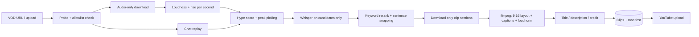

# 🎬 GTA VI Clip Pipeline

**Turn 8-hour GTA VI streams into captioned, vertical YouTube Shorts automatically, free and with no usage limits.**

Paste a Twitch, YouTube or Kick VOD link and the pipeline does the rest:

1. Finds the hype moments: yelling, explosions and sudden volume spikes, plus chat-rate spikes when a chat replay exists.
2. Re-ranks them with free local AI transcription (Whisper), looking for hype words like *"no way"*, *"cops"*, *"clip that"*.
3. Snaps each clip to sentence boundaries so nothing starts or ends mid-word.
4. Downloads **only those sections** in 1080p, so you never pull the whole 10 GB VOD.
5. Renders 1080×1920 Shorts in one of several layouts (blur-fill or facecam-on-top) with bold word-by-word captions and a credit line for the streamer.
6. Writes the title, description (with a timestamped source link) and tags, then optionally uploads to YouTube.

Everything runs on your own machine or on free GitHub Actions runners. There are no paid APIs, no credits and no watermark.

---

## Contents
- [How it works](#how-it-works)
- [Quick start (Docker)](#quick-start-docker)
- [Quick start (Python)](#quick-start-python)
- [Run it free on GitHub Actions](#run-it-free-on-github-actions)
- [Auto-watch channels](#auto-watch-channels)
- [YouTube upload setup](#youtube-upload-setup)
- [Streamer allowlist & credit](#streamer-allowlist--credit)
- [Configuration](#configuration)
- [Free 24/7 hosting options](#free-247-hosting-options)
- [Troubleshooting](#troubleshooting)

## How it works



| Signal | What it catches | Cost |
|---|---|---|
| Loudness vs. a rolling 5-min baseline | streamer screaming, explosions, crashes | streamed at 8 kHz, about 1 min of CPU per 8 h VOD |
| Loudness rise | sudden "OH MY GOD" moments | free |
| Chat messages/sec | the moments chat went wild (YouTube live replays; Twitch with `chat-downloader`) | one request |
| Scene cuts (optional) | heavy action, for uploaded files | decodes at 1 fps |
| Transcript keywords | "no way", "cops", "five stars", "clip that"… | Whisper runs only on the top candidates |

## Quick start (Docker)

```bash
git clone https://github.com/<you>/<this-repo>.git && cd <this-repo>
docker compose up -d --build
# open http://localhost:8000
```

Clips, the database and your YouTube token are stored in `./data`, and settings in `./config`.

> Want a password because you're exposing it to the internet? Set `CLIPPER_PASSWORD=yourpass` in a `.env` file next to `docker-compose.yml`.

## Quick start (Python)

Requires Python 3.10+ and **ffmpeg** (`sudo apt install ffmpeg`, `brew install ffmpeg` or `winget install ffmpeg`).

```bash
python -m venv .venv && source .venv/bin/activate   # Windows: .venv\Scripts\activate
pip install -r requirements.txt

python -m clipper serve                 # web app on http://localhost:8000
# or straight from the terminal:
python -m clipper run "https://www.twitch.tv/videos/2345678901" --clips 5 --layout facecam
python -m clipper run ./my_recording.mp4 --streamer "StreamerName" --layout blur
```

CLI options: `--clips`, `--min-seconds`, `--max-seconds`, `--layout blur|facecam|crop|landscape`, `--facecam-box x,y,w,h`, `--no-captions`, `--whisper-model tiny|base|small|medium`, `--language en`, `--scenes`, `--cookies cookies.txt`, `--upload`, `--privacy`.

## Run it free on GitHub Actions

GitHub-hosted runners are **free and unlimited for public repositories** (up to 6 h per run), so you don't even need a PC on.

1. Push this repo to GitHub (public).
2. Add each streamer you clip to `config/streamers.yaml` and commit (see [allowlist](#streamer-allowlist--credit)).
3. Go to **Actions → Clip a VOD → Run workflow**, then paste the URL and pick a layout.
4. Download the finished clips from the run's **clips** artifact. A summary table shows every clip's title, timestamp and score.

Repository secrets (Settings → Secrets and variables → Actions):

| Secret | Needed for |
|---|---|
| `YT_CLIENT_SECRET_JSON` | YouTube upload: contents of `client_secret.json` |
| `YT_TOKEN_JSON` | YouTube upload: contents of `data/youtube_token.json` after `auth-youtube` |
| `YTDLP_COOKIES` | optional: Netscape `cookies.txt` content if YouTube shows "Sign in to confirm you're not a bot" |

> YouTube often blocks downloads from datacenter IPs such as GitHub runners. Twitch and Kick VODs work reliably there. For YouTube sources, either add `YTDLP_COOKIES` or run the Docker app at home.

## Auto-watch channels

List channels in `config/watchlist.yaml`. The **Watch channels** workflow then runs every 3 hours, finds new VODs whose titles mention GTA 6 / GTA VI, clips them and records processed IDs in `state/processed.json`. Set the repository variable `AUTO_UPLOAD=true` to publish automatically.

```yaml
channels:
  - url: https://www.twitch.tv/<streamer>/videos?filter=archives
    clips: 5
    layout: facecam
    facecam_box: [0.0, 0.62, 0.28, 0.38]
```

Locally: `python -m clipper watch --dry-run`.

## YouTube upload setup

You need this once, using your own free Google Cloud project:

1. Go to [Google Cloud Console](https://console.cloud.google.com/), create a project and enable **YouTube Data API v3**.
2. Set up the **OAuth consent screen** as External and add your Google account as a test user. Then click **Publish app**, because apps left in "Testing" have refresh tokens that expire after 7 days.
3. Go to **Credentials → Create credentials → OAuth client ID → Desktop app**, download the JSON and save it as `data/client_secret.json`.
4. Authorize:
   ```bash
   python -m clipper auth-youtube                               # Python
   docker compose run --rm --service-ports clipper auth-youtube  # Docker
   ```
   Open the printed URL and approve. If you're on a remote server, open it from the server's browser, or tunnel port 8090 with `ssh -L 8090:localhost:8090 server`.
5. The web app's **Upload ▶** buttons and the auto-upload toggle are now enabled.

The free API quota (10,000 units/day) allows about **6 uploads per day**. The app enforces `youtube.daily_upload_cap`. Uploads default to **private** so you can review clips first.

## Streamer allowlist & credit

Reuploading other people's streams can get your channel copyright strikes. The pipeline is built to make doing this properly the default:

- **Allowlist**: with `enforce: true`, VOD URLs from channels missing from `config/streamers.yaml` are rejected. Manage the list in the web UI under **Streamers & settings**, and record where each permission came from (clip policy on stream, written OK, etc.).
- **On-video credit**: every clip carries the streamer's channel (for example `twitch.tv/name`) at the top.
- **Description credit**: the streamer name, channel link and a **timestamped link to the original moment**.
- Clips are transformed rather than raw reuploads: reframed, captioned and cut to a single moment.

Many big streamers allow and even encourage clip channels, but check each one's rules. This tool doesn't give legal advice, and you're responsible for what you upload.

## Configuration

All defaults are in [`config/settings.yaml`](config/settings.yaml) and every option is commented. Highlights:

| Key | Default | Meaning |
|---|---|---|
| `clips.count` | 5 | clips per VOD |
| `clips.min_seconds` / `max_seconds` | 20 / 58 | under 60 s so YouTube treats it as a Short |
| `detection.weights.*` | | how much each signal counts |
| `detection.keywords` | GTA hype words | boosts moments where these are said |
| `render.layout` | `blur` | `blur` (16:9 over blurred fill), `facecam` (cam on top, game below), `crop`, `landscape` |
| `render.facecam_box` | bottom-left | where the webcam sits in the source frame (0–1) |
| `captions.model` | `base` | `tiny` is fastest; `small` is more accurate |
| `metadata.title_template` | `{streamer} {hook} 😱 #GTA6 #Shorts` | also `{vod_title}` |
| `download.sections` | `true` | download only highlight sections |

Environment variables: `CLIPPER_PASSWORD`, `CLIPPER_CONCURRENCY`, `WHISPER_DEVICE` (`cuda` if you have an NVIDIA GPU), `WHISPER_THREADS`, `YTDLP_COOKIES_FILE`, `CLIPPER_DATA_DIR`, `CLIPPER_CONFIG_DIR`.

## Free 24/7 hosting options

| Option | Cost | Notes |
|---|---|---|
| Your own PC | free | `docker compose up -d`. Fastest if you have a decent CPU or GPU. |
| GitHub Actions | free (public repo) | no server; click **Run workflow** or use the scheduled watcher |
| Oracle Cloud Always Free VM (4 ARM cores, 24 GB RAM) | free | runs the Docker app 24/7; put it behind [Cloudflare Tunnel](https://developers.cloudflare.com/cloudflare-one/connections/connect-networks/) and set `CLIPPER_PASSWORD` |

Rendering is CPU-heavy, so serverless free tiers (Vercel, Netlify and similar) can't run it.

## Troubleshooting

| Problem | Fix |
|---|---|
| "Sign in to confirm you're not a bot" | export `cookies.txt` from a logged-in browser and set `download.cookies_file` / `YTDLP_COOKIES` |
| "not in your streamer allowlist" | add the channel under **Streamers & settings** |
| Captions slightly off | use `--whisper-model small`, or set `captions.language: en` |
| First job is slow | the Whisper model downloads once (about 150 MB for `base`) and is cached |
| Wrong facecam crop | pick a preset or type the box in the layout panel; the preview shows the crop area |
| `Interrupted by restart` | the job was running when the server stopped. Click **Retry**. |

## Development

```bash
pip install -r requirements-dev.txt
python -m pytest -q
```

Project layout:

```
clipper/
  ingest.py      yt-dlp: metadata, audio-only, section downloads, chat replay
  analysis.py    loudness / rise / chat / scene signals (1 Hz)
  highlights.py  scoring, peak picking, sentence snapping, keyword rerank
  transcribe.py  faster-whisper (word timestamps)
  captions.py    animated word-by-word ASS subtitles
  render.py      ffmpeg layouts + encode
  metadata.py    titles, descriptions, credit
  youtube.py     OAuth + resumable upload
  pipeline.py    orchestration + progress
  jobs.py        SQLite job store + worker threads
  server.py      FastAPI REST API + static web app
  watch.py       channel watcher
web/             dashboard (vanilla JS, no build step)
```

MIT licensed.
